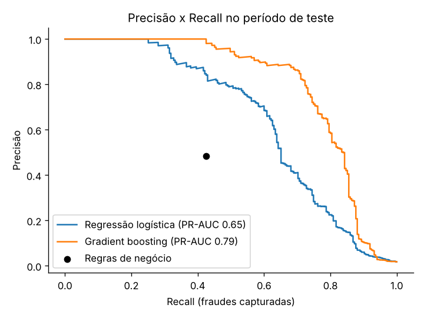
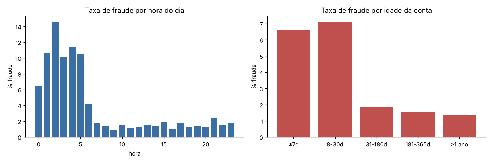
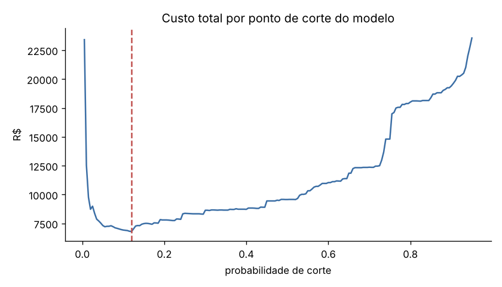

# Detecção de Fraude em Transações Digitais

Análise exploratória, regras de negócio e modelo de machine learning para detectar fraudes em transações,
usando **sinais de dispositivo, localização e comportamento**. O foco é transformar dados em
**recomendações acionáveis** que equilibrem perda evitada e atrito para clientes legítimos.



## Problema

Cerca de 1,8% das transações são fraudes. Bloquear demais irrita o cliente bom, e bloquear de menos gera prejuízo.
As perguntas que o projeto responde:

1. Quais sinais diferenciam uma transação fraudulenta de uma legítima?
2. Regras simples são suficientes ou um modelo traz ganho real?
3. Qual ponto de corte minimiza o custo total para o negócio?

## Dados

Dataset **sintético** com cerca de 59 mil transações em 90 dias, gerado por [`src/gerar_dados.py`](src/gerar_dados.py).
Ele simula quatro padrões de fraude:

| Padrão | Como aparece nos dados |
|---|---|
| **Account takeover** | dispositivo novo, local distante, falhas de login, valor alto, madrugada |
| **Card testing** | rajadas de transações de baixo valor em poucos minutos |
| **Conta falsa** | conta recém-criada, uso de emulador |
| **Fraude camuflada** | sem sinais evidentes (testa os limites do modelo) |

Principais variáveis: `valor`, `dispositivo_novo`, `idade_dispositivo_dias`, `emulador`, `distancia_casa_km`,
`falhas_login_24h`, `idade_conta_dias`, `tx_ultima_1h` (velocidade), `min_desde_ultima`, `hora`, `canal` e `categoria`.

## Abordagem

1. **EDA em SQL (DuckDB):** taxa de fraude por sinal de dispositivo, faixa de distância, velocidade e combinações de sinais ([`sql/analises.sql`](sql/analises.sql)).
2. **EDA visual:** distribuições, perfil de cada tipo de fraude e padrões por hora e idade da conta.
3. **Baseline com regras de negócio:** regras explicáveis para cada padrão de fraude.
4. **Modelos:** regressão logística e gradient boosting, com **validação temporal** (treino nos primeiros 70 dias e teste nos últimos 20, como em produção).
5. **Decisão orientada a custo:** escolha do ponto de corte considerando o valor da fraude aprovada e o custo do bloqueio indevido.

## Principais resultados (período de teste)

| Abordagem | Precisão | Recall | Legítimas bloqueadas | Economia vs. sem prevenção |
|---|---|---|---|---|
| Regras de negócio | 48% | 43% | 0,84% | 29% |
| **Gradient boosting** (corte 0,12) | **65%** | **79%** | **0,79%** | **81%** |

- **PR-AUC** de 0,79 no gradient boosting, contra 0,65 na regressão logística. ROC-AUC de 0,94.
- **Sinais mais fortes:** idade do dispositivo, distância do local habitual, dispositivo novo e falhas de login.
- **Captura por tipo:** o modelo pega 100% das contas falsas, cerca de 95% do card testing e cerca de 86% dos account takeovers. As fraudes camufladas não são capturadas, e essa limitação está documentada, com sugestão de outras fontes de sinal.




## Recomendações

- Usar **regras de alta precisão** (rajadas de card testing) como bloqueio direto e o **score do modelo** para pedir autenticação extra ou revisão manual.
- **Monitorar a deriva** dos sinais semanalmente, porque fraudadores mudam de padrão.
- **Validar o custo de atrito** com Produto e Customer Success. A premissa usada aqui é de R$ 10 por bloqueio indevido, e o ponto de corte ótimo depende dela.
- Para fraudes sem sinais de dispositivo e localização, incorporar **biometria comportamental, histórico de contestações e análise de rede** entre contas.

## Estrutura

```
├── data/transacoes.csv           # dataset sintético
├── notebooks/analise_fraude.ipynb # análise completa (EDA, regras, modelo, custo)
├── sql/analises.sql              # consultas exploratórias em SQL
├── src/gerar_dados.py            # gerador do dataset
├── src/montar_notebook.py        # monta o notebook a partir do código
└── reports/figures/              # gráficos exportados
```

## Como rodar

```bash
pip install -r requirements.txt
python src/gerar_dados.py            # (opcional) recria o dataset
jupyter notebook notebooks/analise_fraude.ipynb
```

## Tecnologias

Python (pandas, NumPy, scikit-learn, Matplotlib), SQL (DuckDB) e Jupyter.

---

**Bruno Franco**, Analista de Dados · [LinkedIn](https://www.linkedin.com/in/brunofrancco/) · [Portfólio](https://brunofrancco.github.io/portifolio-de-projetos)
